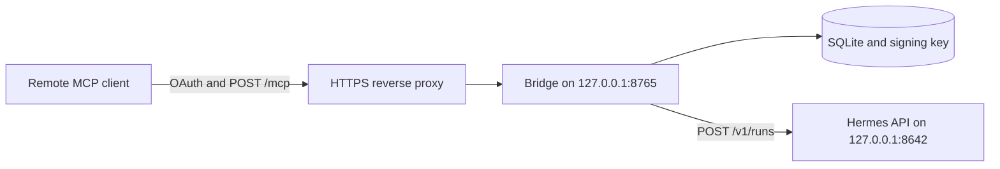

# hermes-agent-mcp-bridge

Expose a local Hermes agent over remote MCP with OAuth 2.1 public-client auth (DCR, CIMD, PKCE).

[](LICENSE)
[](pyproject.toml)
[](.github/workflows/ci.yml)

<!-- TODO: add a demo GIF of connecting a client here. Do not commit a fabricated screenshot. -->

## Why

Official Hermes [`mcp-serve`](https://hermes-agent.nousresearch.com/marketplace/mcp-serve) is local stdio only (`hermes mcp-serve`). This bridge exposes Hermes over remote MCP: streamable HTTP at `{issuer}/mcp`, with standards OAuth 2.1 public-client auth. There is no client secret. Clients register with Dynamic Client Registration or a Client ID Metadata Document, and the authorization-code flow uses PKCE S256. ChatGPT, Cursor, and other MCP clients can connect. The agent, its tools, and its credentials stay on loopback.

The remote client queues a prompt and reads the reply (`ask_hermes`, `get_job`, `bridge_status`). It does not receive the agent's own tools.

## Architecture



The public listener serves discovery, `POST /oauth/register`, `POST /oauth/token`, `GET /oauth/jwks`, and `POST /mcp`. With the default `consent.exposure: public`, the approval page is `GET /oauth/authorize` on that same origin. `consent.exposure: tailnet` serves approval only on `consent.bind_port`. See [docs/SETUP.md](docs/SETUP.md) and [docs/SECURITY.md](docs/SECURITY.md).

## Quickstart: connect ChatGPT in 5 minutes

ChatGPT is expected to work with a developer-mode custom MCP connector. A live ChatGPT session is not part of this repository's tests. The checklist is in [docs/CLIENTS.md](docs/CLIENTS.md). Use a separate data directory, port, and issuer for a first test.

You need Python 3.11 or newer, a Hermes Agent 0.21.x API server on `127.0.0.1:8642`, and an HTTPS name that forwards to the bridge. Docker and a longer Tailscale walkthrough are in [docs/SETUP.md](docs/SETUP.md).

1. On the Hermes host, enable the API server (Hermes 0.21 uses `~/.hermes/.env` for these two variables) and start the gateway:

   ```
   API_SERVER_ENABLED=true
   API_SERVER_KEY=replace-with-a-long-random-string
   ```

   ```bash
   hermes gateway
   ```

2. Install the bridge, point `server.issuer` and `server.resource` at that public origin, and start it. `resource` is the MCP URL. It defaults to `issuer + /mcp`. Neither value may have a trailing slash. Leave `consent.exposure: public` (the example default) so the approval page is on the issuer origin.

   ```bash
   python -m venv .venv
   .venv/bin/pip install -e .
   cp config.example.yaml config.yaml
   # edit server.issuer and server.resource
   mkdir -p secrets
   umask 077
   printf '%s\n' 'replace-with-a-long-random-string' > secrets/hermes_api_key
   chmod 0600 secrets/hermes_api_key
   .venv/bin/hermes-agent-mcp-bridge init --config config.yaml
   .venv/bin/hermes-agent-mcp-bridge serve --config config.yaml
   ```

   `init` prints the owner password once. Store it in a password manager. `serve` binds `127.0.0.1:8765` and does not print the password.

3. Publish that loopback port over HTTPS. With Tailscale, confirm the flags on your client (`tailscale funnel --help`), then:

   ```bash
   tailscale funnel --bg 8765
   ```

   Set `server.issuer` to the HTTPS origin that command shows, with no path and no trailing slash, and set `server.resource` to that origin plus `/mcp`. Do not publish the Hermes port `8642`.

4. Check discovery from the bridge machine:

   ```bash
   curl -sS http://127.0.0.1:8765/healthz
   curl -sS http://127.0.0.1:8765/.well-known/oauth-protected-resource
   curl -sS http://127.0.0.1:8765/.well-known/oauth-authorization-server
   ```

   The authorization-server document includes `code_challenge_methods_supported: ["S256"]`, `registration_endpoint`, `client_id_metadata_document_supported: true`, `token_endpoint_auth_methods_supported: ["none"]`, and `authorization_response_iss_parameter_supported: true`.

5. In ChatGPT, enable developer mode and add a custom MCP connector. Paste the `resource` URL (`https://bridge.example.com/mcp` with your host). Do not paste a bearer token. You do not create a client id. CIMD and DCR are both advertised. When the approval page opens, deny the request if the redirect host is not `chatgpt.com`. Otherwise enter the owner password from `init`.

6. Call `bridge_status`, then `ask_hermes` with a short prompt, then `get_job` with the returned job id.

ChatGPT's stable redirect, when the server sends RFC 9207 `iss` on every redirect, is `https://chatgpt.com/connector_platform_oauth_redirect`, with the CIMD document `https://chatgpt.com/oauth/client.json`. Both that form and the per-connection `https://chatgpt.com/connector/oauth/{callback_id}` form are accepted. This server does not verify `private_key_jwt` client assertions. The public-client method is `none`.

## Connect Cursor

Cursor is expected to work through Dynamic Client Registration. A live Cursor session is not part of this repository's tests.

1. Use the same bridge as above. Leave `redirects.private_schemes` at the example default, `cursor`. A private-use URI is accepted when its authority contains a dot, which covers `cursor://anysphere.cursor-mcp/oauth/callback`. Set `redirects.private_schemes` to `[]` to refuse that scheme. HTTPS and loopback redirects still register.
2. Add a remote MCP server whose URL is `server.resource`. Cursor's user `mcp.json`, or a project `.cursor/mcp.json`, is:

   ```json
   {
     "mcpServers": {
       "hermes-agent": {
         "url": "https://bridge.example.com/mcp"
       }
     }
   }
   ```

   Omit `headers` and omit `auth`. This bridge does not accept a static bearer on `POST /mcp`, and it rejects a client secret at `POST /oauth/register`. Cursor registers itself. There is no client id to paste.
3. Registration may list `cursor://anysphere.cursor-mcp/oauth/callback`, `https://www.cursor.com/agents/mcp/oauth/callback`, and a loopback URI such as `http://localhost:8787/callback`. Unusable URIs are dropped. The rest are kept. Loopback HTTP ignores the port and treats `localhost`, `127.0.0.1`, and `[::1]` as the same host.
4. Approve `/oauth/authorize` with the owner password after you read the client name and the redirect URI. The only scope this server advertises is `hermes:ask`.
5. Call `bridge_status`, then `ask_hermes`, then `get_job`.

## Tools

| Tool | Effect |
|---|---|
| `ask_hermes` | Queue a prompt. Returns a job id. |
| `get_job` | Read that job. The reply is included when the job has succeeded. |
| `bridge_status` | Version, queue depth, and whether the local agent health check answered. |
| `ask_hermes_sync` | Optional. Waits up to `sync_timeout_seconds` (120 at most) and otherwise returns the job id so the client can poll. Off unless `limits.sync_ask_enabled` is true. |

Access tokens are short-lived RS256 JWTs. Refresh tokens rotate in SQLite. The signing key is created on first run at `data/signing-key.pem` with mode `0600`.

## Clients

| Client | Status |
|---|---|
| Grok Bot custom connector | The only remote client this design has been used with. The automated tests do not open a live Grok Bot session. |
| ChatGPT developer-mode custom MCP connector | Expected to work. Not yet verified live. See [docs/CLIENTS.md](docs/CLIENTS.md). |
| Claude custom connector | Expected to work (CIMD or DCR). Not yet verified live. |
| Cursor remote MCP | Expected to work (DCR). Not yet verified live. |

## How this differs from similar projects

| | This bridge | [mlennie/hermes-mcp](https://github.com/mlennie/hermes-mcp) | [iamsupersocks/grokbot-hermes-bridge](https://github.com/iamsupersocks/grokbot-hermes-bridge) |
|---|---|---|---|
| Who can connect | Any remote MCP client that can do OAuth 2.1 as a public client | OAuth clients that can hold a client secret you minted, plus an optional static bearer | OAuth clients, documented around Grok Bot |
| Client registration | DCR and Client ID Metadata Documents, both persisted | DCR disabled. Static client id and secret | DCR. Clients stored in a JSON file |
| Consent | Owner password. Optional separate listener that is not placed on a public funnel | Authorize auto-approves. The client secret is the gate | Owner code. Pending approvals and authorization codes are in memory |
| Tokens | Short-lived RS256 access tokens, rotating refresh tokens in SQLite, RFC 9207 `iss` on the redirect | Confidential client plus PKCE | Access and refresh tokens. Rotating the owner secret invalidates tokens |
| Tools | `ask_hermes`, `get_job`, `bridge_status`, optional bounded `ask_hermes_sync` | A synchronous ask tool (see that project's README) | `hermes_ask` and `hermes_status` |
| Agent API | Hermes 0.21 runs API on loopback, or a CLI adapter you configure | Hermes OpenAI-compatible HTTP API | Hermes CLI |
| Exposure | Bind loopback. Tailscale Funnel/Serve is documented, including a tailnet-only consent port | A tunnel you configure | A tunnel you configure |

Those projects solve the same shape of problem. Read their READMEs for their current behavior. The rows above describe the public documentation as of November 2026.

## Documentation

- [docs/SETUP.md](docs/SETUP.md) — install, Hermes API, Tailscale, connect, verify
- [docs/CLIENTS.md](docs/CLIENTS.md) — Grok Bot, ChatGPT, Claude, Cursor, and the ChatGPT test checklist
- [docs/CONFIGURATION.md](docs/CONFIGURATION.md) — config file and environment variables
- [docs/SECURITY.md](docs/SECURITY.md) — threat model, allowlist, consent, keys
- [docs/TROUBLESHOOTING.md](docs/TROUBLESHOOTING.md) — `invalid_request`, redirect mismatch, stale client id
- [docs/RELEASE_NOTES_v0.1.0.md](docs/RELEASE_NOTES_v0.1.0.md)
- [CONTRIBUTING.md](CONTRIBUTING.md)
- [CHANGELOG.md](CHANGELOG.md)

## Tests

```bash
python -m venv .venv
.venv/bin/pip install -e ".[dev]"
.venv/bin/ruff check hermes_agent_mcp_bridge tests
.venv/bin/pytest -q
```

The tests use an in-memory Hermes double. They do not contact a live agent or a live chat client. CI is [`.github/workflows/ci.yml`](.github/workflows/ci.yml) (Python 3.12, ruff, pytest, gitleaks).

## License

MIT. See [LICENSE](LICENSE). The Python dependencies used here (`cryptography`, `httpx`, `PyJWT`, `pydantic`, `PyYAML`, `python-multipart`, `starlette`, `uvicorn`) are MIT, BSD, or Apache-2.0. Nothing in this tree is vendored from another project.

## Trademarks

Grok, Grok Bot, ChatGPT, OpenAI, Claude, Anthropic, Cursor, Tailscale, Hermes, and Nous are trademarks of their respective owners. This project is not affiliated with, endorsed by, or sponsored by those owners.
