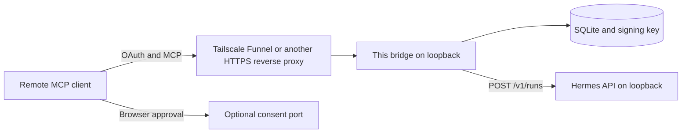

# hermes-agent-mcp-bridge

A self-hosted [MCP](https://modelcontextprotocol.io) server that lets a remote client submit prompts to a [Hermes Agent](https://hermes-agent.nousresearch.com) running on your machine. The client speaks OAuth 2.1. The agent stays on loopback.

The bridge is client-neutral. It is a public OAuth client (no client secret), with Dynamic Client Registration, Client ID Metadata Documents, PKCE S256, resource indicators, refresh tokens, and an owner consent step. Connected clients and queued jobs are stored in SQLite, so a process restart does not drop them. The signing key is generated on first run and stored with mode `0600`.

## What it is for

- Use a remote chat client as the interface and keep the agent, its tools, and its credentials on a machine you control.
- Give that client a short allowlist: queue a prompt, poll the job, read status. The client's HTTP call does not have to stay open for the whole agent run.
- Survive restarts. Registered clients, refresh tokens, and job rows are in SQLite. Access tokens are short-lived JWTs signed by a local key.

## What it is not

This is not a proxy that exposes every tool the local agent has. The remote client can submit a prompt and read the reply. Whatever the local agent is allowed to do is configured on the agent, not here.

It is a single-owner bridge. There are no accounts and no per-user isolation beyond that one owner password.

## Clients

| Client | Status |
|---|---|
| Grok Bot custom connector | The only remote client this design has been used with. The automated tests in this repository do not open a live Grok Bot session. |
| ChatGPT developer-mode custom MCP connector | Expected to work. Not yet verified live. See the checklist in [docs/CLIENTS.md](docs/CLIENTS.md). Use a separate test port and data directory. |
| Claude custom connector | Expected to work (CIMD or DCR). Not yet verified live. |
| Cursor remote MCP | Expected to work (DCR, including the `cursor://` redirect when that scheme is enabled). Not yet verified live. |

Per-client steps, redirect URIs, and the ChatGPT checklist are in [docs/CLIENTS.md](docs/CLIENTS.md).

## How this differs from similar projects

| | This bridge | [mlennie/hermes-mcp](https://github.com/mlennie/hermes-mcp) | [iamsupersocks/grokbot-hermes-bridge](https://github.com/iamsupersocks/grokbot-hermes-bridge) |
|---|---|---|---|
| Who can connect | Any remote MCP client that can do OAuth 2.1 as a public client | OAuth clients that can hold a client secret you minted, plus an optional static bearer | OAuth clients, documented around Grok Bot |
| Client registration | DCR and Client ID Metadata Documents, both persisted | DCR disabled. Static client id and secret | DCR. Clients stored in a JSON file |
| Consent | Owner password. Optional separate listener that is not placed on a public funnel | Authorize auto-approves. The client secret is the gate | Owner code. Pending approvals and authorization codes are in memory |
| Tokens | Short-lived RS256 access tokens, rotating refresh tokens in SQLite, RFC 9207 `iss` on the redirect | Confidential client plus PKCE | Access and refresh tokens. Rotating the owner secret invalidates tokens |
| Tools | `ask_hermes`, `get_job`, `bridge_status`, optional bounded `ask_hermes_sync` | A synchronous ask tool (see that project's README) | `hermes_ask` and `hermes_status` |
| Agent API | Hermes 0.21 runs API on loopback, or a CLI adapter you configure | Hermes OpenAI-compatible HTTP API | Hermes CLI |
| Exposure | Bind loopback. Tailscale Funnel/Serve is documented, including a tailnet-only consent port | A tunnel you configure | A tunnel you configure |

Those projects solve the same shape of problem. Read their READMEs for their current behavior. The rows above describe the public documentation as of November 2026.

## Architecture



The public listener serves discovery, registration, the token endpoint, JWKS, and `/mcp`. In the default `consent.exposure: public` mode the approval page is on that same origin, which is what current ChatGPT documentation expects. In `tailnet` mode the approval routes are served only on a second loopback port. Publish that port with Tailscale Serve and do not put it on Funnel. See [docs/SETUP.md](docs/SETUP.md) and [docs/SECURITY.md](docs/SECURITY.md).

On first start the process creates `data/signing-key.pem` (mode `0600`) and `data/bridge.sqlite3`. Nothing in that directory belongs in git.

## Tools

| Tool | Effect |
|---|---|
| `ask_hermes` | Queue a prompt. Returns a job id. |
| `get_job` | Read that job. The reply is included when the job has succeeded. |
| `bridge_status` | Version, queue depth, and whether the local agent health check answered. |
| `ask_hermes_sync` | Optional. Waits up to `sync_timeout_seconds` (120 at most) and otherwise returns the job id so the client can poll. Off unless `limits.sync_ask_enabled` is true. |

## Quick start

Python 3.11 or newer. A Hermes Agent 0.21.x API server on `127.0.0.1:8642` is the supported backend. The step-by-step, including Docker and Tailscale, is [docs/SETUP.md](docs/SETUP.md).

```bash
python -m venv .venv
.venv/bin/pip install -e .
cp config.example.yaml config.yaml
# edit issuer and resource to the exact public HTTPS origin you will use
.venv/bin/hermes-agent-mcp-bridge init --config config.yaml
# put the Hermes API key in secrets/hermes_api_key (mode 0600)
.venv/bin/hermes-agent-mcp-bridge serve --config config.yaml
```

`init` prints the owner password once. Store it in a password manager. `serve` never prints it.

## Documentation

- [docs/SETUP.md](docs/SETUP.md) — install, Hermes API, Tailscale, connect, verify
- [docs/CLIENTS.md](docs/CLIENTS.md) — Grok Bot, ChatGPT, Claude, Cursor, and the ChatGPT test checklist
- [docs/CONFIGURATION.md](docs/CONFIGURATION.md) — config file and environment variables
- [docs/SECURITY.md](docs/SECURITY.md) — threat model, allowlist, consent, keys
- [docs/TROUBLESHOOTING.md](docs/TROUBLESHOOTING.md) — `invalid_request`, redirect mismatch, stale client id
- [CONTRIBUTING.md](CONTRIBUTING.md)
- [CHANGELOG.md](CHANGELOG.md)

## Tests

```bash
python -m venv .venv
.venv/bin/pip install -e ".[dev]"
.venv/bin/ruff check hermes_agent_mcp_bridge tests
.venv/bin/pytest -q
```

The tests use an in-memory Hermes double. They do not contact a live agent or a live chat client.

## License

MIT. See [LICENSE](LICENSE). The Python dependencies used here (`cryptography`, `httpx`, `PyJWT`, `pydantic`, `PyYAML`, `python-multipart`, `starlette`, `uvicorn`) are MIT, BSD, or Apache-2.0. Nothing in this tree is vendored from another project.

## Trademarks

Grok, Grok Bot, ChatGPT, OpenAI, Claude, Anthropic, Cursor, Tailscale, Hermes, and Nous are trademarks of their respective owners. This project is not affiliated with, endorsed by, or sponsored by those owners.

## Publishing this folder as its own repository

This directory is the whole project. To publish it as the first commit of an empty GitHub repository named `hermes-agent-mcp-bridge`:

```bash
git clone https://github.com/OWNER/hermes-agent-mcp-bridge.git publish
rsync -a --exclude .venv --exclude data --exclude secrets --exclude __pycache__ \
  public/hermes-agent-mcp-bridge/ publish/
cd publish
git add .
git status   # confirm there is no .env, no pem, no sqlite, and no secrets directory
git commit -m "Initial public release of hermes-agent-mcp-bridge"
git branch -M main
git push -u origin main
```

Do not copy the history of the private repository this folder was developed in. Do not copy a live `data/` directory or signing key.
